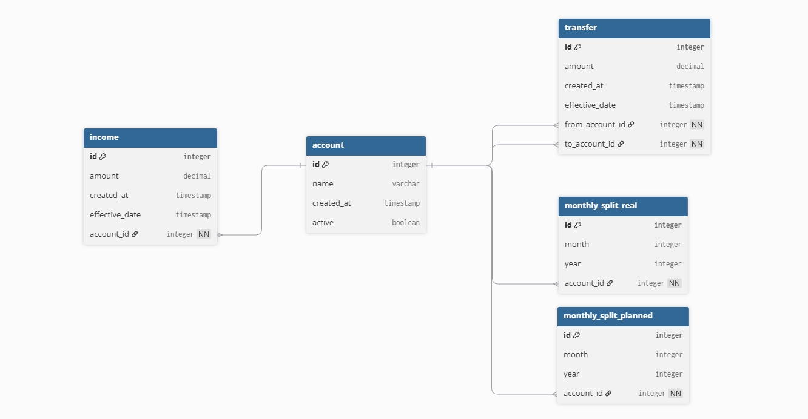

# FinanceApp

FinanceApp helps you track your finances easily.  
It allows you to manage multiple bank accounts, investments, and transfers in one place.

It is usual to own many bank accounts for different purposes: investing, saving up, daily usage... This makes difficult to track the money. To maintain good finances it is useful to have everything tracked in one place. This allows planning ahead and prevents that sense of moving money with no purpose.

# Useful Links
Domain model (UML)
- ERD (Entity Relationship Diagram): https://dbdiagram.io/d/6988d001bd82f5fce207a50d



- Time Tracker: https://track.toggl.com/timer
- Figma: https://www.figma.com/design/woEmmTwFi1JKnyUZOcUek2/FinanceApp-v2?t=WkrJKEab9Lb9dFqG-0
- Stitch (AI design): https://stitch.withgoogle.com/projects/16204193569097462166?pli=1
- BrandFetch (Brand Logos): https://brandfetch.com/

# Features

> **Legacy note.** This Features list is **legacy** and retained for historical
> reference. The canonical functional backlog is now
> [`docs/product-backlog.md`](docs/product-backlog.md), which carries permanent
> requirement IDs and status. This list has not been fully migrated or
> re-validated; prefer the backlog and OpenSpec specs for current status. See
> [Development Workflow](#development-workflow).

Features that need further clarification can reference a spec file using `[spec:name]`:

```
- Monthly Splits across accounts 🟨 [spec:monthly-splits]
- Investments in different products 🔷 [spec:investments]
```

Spec files live under `/specs`. See [Spec Workflow](#spec-workflow) for details.

## Main Features

- Configuration
  - TurboRepo monorepo with 2 packages: web and db ✅
  - Next.js for frontend and backend ✅
  - Prisma ORM for database management ✅
  - MariaDB as the database ✅
  - Tailwind CSS for styling (+shadcn/ui) ✅
  - TypeScript for type safety ✅
  - Setup Docker for containerization 🟨
  - Fix Prisma console not working 🟨
  - New package: mobile 🟨
  - New package: shared (for shared types and utils) 🟨
  - New package: api 🟨
- Create & List
  - Accounts ✅
  - Disabled accounts 🟨
  - Incomes to these accounts ✅
  - Expenses from these accounts ✅
  - Recurrent expenses (fixed and variable) ✅
  - Recurrent incomes (start-of-month auto-apply) ✅
  - Recurrent transactions ✅
  - Transactions between accounts ✅
  - Monthly Budget per month (set a spending target) ✅
  - Monthly Splits across accounts (The splits planned at the beginning of the month) (recurrent transactions) 🟨
  - Investments in different products in these accounts [spec:investments] ✅
  - Recurrent investments �
- View
  - Account details ✅
  - Current Month ✅
  - Past Months with old account state ✅
  - Month details (Incomes and splits, individual transactions) ✅
  - Current amount in each account ✅
  - Metrics page with basic data ✅
  - Monthly splits, planned and real 🟨
  - Performance of these investments ✅
  - Todo tab with pending todo recurrent expenses and recurrent transactions that are not marked as automated (bool attribute) 🟨
  - Sort, filter and search accounts, transactions, incomes and expenses 🟨
  - Sort, filter and paginate incomes, expenses and transactions by month ✅
  - Plot data related with different financial products [spec:financial-product-data] ✅
- Actions
  - Select account instead of account id when creating transactions and incomes ✅
  - Pause and resume recurrent incomes 🟨
  - Pause and resume recurrent expenses 🟨
  - Delete recurrent incomes (with its associated incomes) ✅
  - Delete recurrent expenses (with its associated expenses) ✅
  - Modify recurrent incomes start and end dates 🟨
  - Modify recurrent expenses start and end dates 🟨
  - Modify recurrent transactions start and end dates 🟨
  - Allow recurrent incomes with no end date ✅
  - Allow recurrent expenses with no end date ✅
  - Allow recurrent transactions with no end date ✅
  - Enable/Disable account 🟨
  - Edit account details ✅
  - Edit income and expense details ✅
  - Edit transaction details ✅
  - Delete individual transactions, incomes and expenses ✅
  - Modify recurrent income, expense and transaction frequency 🟨
- Scheduled job to apply pending incomes, expenses and transactions at the end of the day 
  - API endpoint ✅
  - Automate with server cron 🟨
- I want to be able to differentiate the expense actual value and the one used for expense metrics. "Adjust for analytics" ✅
- The admin can enable and disable the debug mode. In debug mode, there will be additional columns shown in the tables ✅
- Hide the "Adjust for analytics" field if not needed ✅
- Year analytics with the total amount of incomes, expenses and transactions for the year 🟨
- Bugs
  - In the account section, transactions for this account, I can only see the "to" column. I can add the from column too or use two separate tables for incoming and outgoing transactions ✅
  - Assets provider [spec:assets-provider] ✅
  - When I shift + click a row from Accounts table it doesn´t open a new tab 🟨
  - Current Month is not showing as active in the navbar ✅
  - You can add one tracked asset to the list as a duplicate and it causes frontend errors ✅
  - Asset plots always show $ and it´s not taking in account the initial currency conversion 🟨
- Design
  - Allow account icon ✅
  - Prioritize icons and visual cues for better UX 🟨
  - Improve cleanliness and usability of the UI (data-driven application) 🟨
  - Implement calendar for better dates visualization 🟨
- Infrastructure
  - Deploy prod version 🟨
- Misc
  - Migrate tables to two different components one more data-driven and one more list styled ✅
  - Create development workflow with integrated AI ✅
  - Upload erd dbdocs file and update erd.png 🟨
  - Example database data for app testing ✅
  - Add native authentification layer with nextjs [spec:basic-authentication] ✅
  - Create a covering test suite 🟨
  - Add sparklines (miniature plots) next to the different assets [spec:sparklines] ✅
  - Portfolio allocation drift [spec:portfolio-drift] 🟨
  - Asset comparison mode [spec:asset-comparison] ✅
  - Financial milestones. Track things like €10k invested, €25k net worth, or 1 year of expenses invested [spec:financial-milestones] 🟨
  - Contribution history. When viewing an asset chart, overlay small markers showing when you bought [spec:contribution-history] ✅
  - Assets Background Sync [spec:assets-background-sync] 🟨
  - Portfolio exposure analysis [spec:portfolio-exposure] ✅
  - Portfolio performance [spec:portfolio-performance] ✅

### Status Legend
🟨 Pending
🔷 Ongoing
✅ Completed

# Setup

### 0. Prerequisites

- Node.js (v20)
- Docker (20.10)
- Turborepo (11.10.0)

### 1. Clone the repository
```bash
git clone https://github.com/ezegonmac/FinanceApp_v2.git
cd FinanceApp_v2
```

### 2. Install dependencies
```
npm install
```

### 3. Configure environment variables

Copy each `.env.example` to `.env`:

| File | Purpose |
|------|---------|
| `.env` | App port, DB connection, cron secret |
| `apps/web/.env` | Web-specific (CRON_SECRET) |
| `packages/db/.env` | `DATABASE_URL` for Prisma CLI migrations |

> `packages/db/.env` must have a `DATABASE_URL` matching the root DB values.

For authentication (`apps/web/.env`), set these values:
- AUTH_SECRET: random 32+ character string used to sign/encrypt session tokens
- AUTH_USER_EMAIL: the single user's email address
- AUTH_USER_PASSWORD: the single user's password

### 4. Start the database container
```
npm run db:start
```

### 5. Run Prisma migrations
Apply existing migrations to the database:
```
npx turbo db:deploy
```

> **Note:** Migrations are NOT applied automatically on `dev` startup. You must run this manually after creating a new database or pulling new migrations.

### 6. Start development server
From the project root folder run:
```
npx turbo run dev --filter=web
```
The app starts on the port defined by `WEB_PORT` in `.env` (default `3000`):
```
http://localhost:3000
```

# Working with Multiple Branches (Worktrees)

Use git worktrees to run multiple branches simultaneously, each with its own Kiro session.

### 1. Create a worktree for parallel work

```bash
git worktree add ../finance-design -b feature/design
```

This creates a second working directory on a separate branch:
```
~/projects/
  finance-app/        -> feature/auth   (original)
  finance-app-design/     -> feature/design (worktree)
```

### 2. Configure each instance

Each worktree has its own `.env`. Use different ports and (optionally) different databases:

**Instance A** (`.env`):
```env
WEB_PORT=3000
DB_PORT=3309
```

**Instance B** (`.env`):
```env
WEB_PORT=3001
DB_PORT=3310
```

If using separate databases, also update `DB_NAME` and `packages/db/.env` accordingly.

### 3. Run independently

Open each folder in its own VS Code/Kiro window. Run `npx turbo run dev --filter=web` in each. The agents won't interfere since they operate on different branches and directories.

### 4. Merge when ready

```bash
git checkout main
git merge feature/backend
git merge feature/frontend
```

Resolve conflicts if needed.

# Connect to database
Confirm that the database container is running
```
docker ps
```
Exec into the container and enter password
```
docker exec -it <DB_CONTAINER_NAME> mariadb -u <DB_USER> -p
```

# Load database dump
If you have a `db-dump.sql` file, restore it with:
```
docker exec -i <DB_CONTAINER_NAME> mariadb -u <DB_USER> -p<DB_PASSWORD> <DB_NAME> < db-dump.sql
```
To create a dump from your current database:
```
docker exec <DB_CONTAINER_NAME> mariadb-dump -u <DB_USER> -p<DB_PASSWORD> --complete-insert --skip-comments <DB_NAME> > db-dump.sql
```

# Reset the database container
```
npx turbo db:force_reset
```

# Stop the database container
```
npm run db:stop
```

# Run Prisma DB viewer
From packages/db run
```
npx prisma studio
```

# Scheduled job: daily job
The endpoint below processes PENDING incomes, expenses and transactions for the current month using Europe/Madrid timezone.
It also applies active recurrent incomes and recurrent investments once per month (idempotent run-log by month), syncs investment prices, and fetches portfolio exposure data (sector & country breakdowns) from Yahoo Finance.
```
POST /api/internal/jobs/apply-pending-transactions
Authorization: Bearer <CRON_SECRET>
```

Snapshot lifecycle:
- Recalculates current month snapshots for all active accounts (live/provisional values)
- Finalizes previous month snapshots (`is_final = true`, `closed_at` set)
- Keeps historical months locked unless data is edited and recalculated

Month snapshots endpoint:
```
GET /api/months/:year/:month/snapshots
```
For the current month, snapshots are refreshed before returning data so metrics are always available.

Example cURL:
```
curl -X POST http://localhost:3000/api/internal/jobs/apply-pending-transactions \
  -H "Authorization: Bearer <CRON_SECRET>"
```

To automate from a server cron (daily near end of day in Europe/Madrid):
```
55 23 * * * curl -X POST http://localhost:3000/api/internal/jobs/apply-pending-transactions -H "Authorization: Bearer <CRON_SECRET>"
```

# Dev workflow

ERD → Prisma schema → Migration → Prisma Client → API → UI

Prisma schema: 
```
packages/db/prisma/schema.prisma
```

Run prisma migration (from packages/db): 
```
npx prisma migrate dev --name <schema_name>
```
or (prefered):
```
npx turbo db:migrate -- --name <schema_name>
```

Generate prisma client:
(from the root folder)
```
npx turbo db:generate
```

## Install new dependencies
From the root folder run
```
npm install <dependency_name> --workspace=<package_name>
```
ie:
```
npm install zod --workspace=apps/web
```

# Spec Workflow

> **Deprecated / Legacy.** The free-form spec workflow below (the Features list
> above plus one-page files under `/specs/<feature-name>.md` linked via
> `[spec:name]`) is **no longer the recommended workflow**. It is kept for
> historical reference only. New functional work follows
> [Development Workflow](#development-workflow) (OpenSpec). The `/specs/` files
> have not been migrated or validated and are not the source of truth.
>
> <details><summary>Legacy spec workflow (historical)</summary>
>
> The Features section acted as the project backlog. Spec files were optional —
> created only when a feature needed more thought before implementation.
> Convention: append `[spec:feature-name]` to a backlog entry to link its spec
> (e.g. `- Monthly Splits across accounts 🟨 [spec:monthly-splits]`). Specs lived
> under `/specs/<feature-name>.md`; see `/specs/_example.md` for the structure.
>
> </details>

# Development Workflow

We are currently in a **documentation and discovery phase**: documenting existing
functionality, reviewing the current implementation, and establishing reliable
specifications **before** starting new feature development. We have adopted
**OpenSpec** as the canonical, spec-driven workflow for all future functional
changes.

### Where things live

| Location | Responsibility |
|---|---|
| [`docs/product-backlog.md`](docs/product-backlog.md) | Central functional **backlog** and ID registry — including ideas not yet approved. Permanent IDs follow the project's [ID conventions](docs/project-documentation-and-sdd-plan.md). |
| `openspec/specs/` | **Canonical approved** functional specifications (what the system is agreed to do). |
| `openspec/changes/` | Proposed and approved **changes** currently being specified or implemented. |
| [`docs/`](docs/) | Project documentation: the SDD plan, the current-state assessment, discovery reports, and methodology. |
| `.kiro/steering/` | Persistent instructions and project context for Kiro. |
| `/specs/` | **Legacy** free-form feature notes, retained for reference (see note above). |

### Creating a new feature

1. **Capture the idea** — record a sufficiently defined idea in
   [`docs/product-backlog.md`](docs/product-backlog.md) and assign it a permanent
   ID per the ID conventions.
2. **Explore and clarify** — investigate the existing implementation and clarify
   requirements before proposing changes.
3. **Specify the change** — create an OpenSpec change proposal with requirements
   and scenarios (`/opsx-propose`).
4. **Review and approve** — review the proposal before implementation begins.
5. **Implement** — develop the feature from the approved change and its tasks.
6. **Validate** — run the relevant tests and verify the implementation satisfies
   the approved requirements.
7. **Complete** — update the canonical `openspec/specs/` to reflect the
   implemented behavior and archive the completed change per the OpenSpec
   workflow.

The methodology behind this is documented in
[`docs/project-documentation-and-sdd-plan.md`](docs/project-documentation-and-sdd-plan.md).

# Screenshots


# Tech Stack
- Frontend: Next.js, Tailwind CSS
- Backend: Next.js, Prisma ORM
- Database: MariaDB
- Monorepo: Turborepo
- Development Tools: TypeScript
